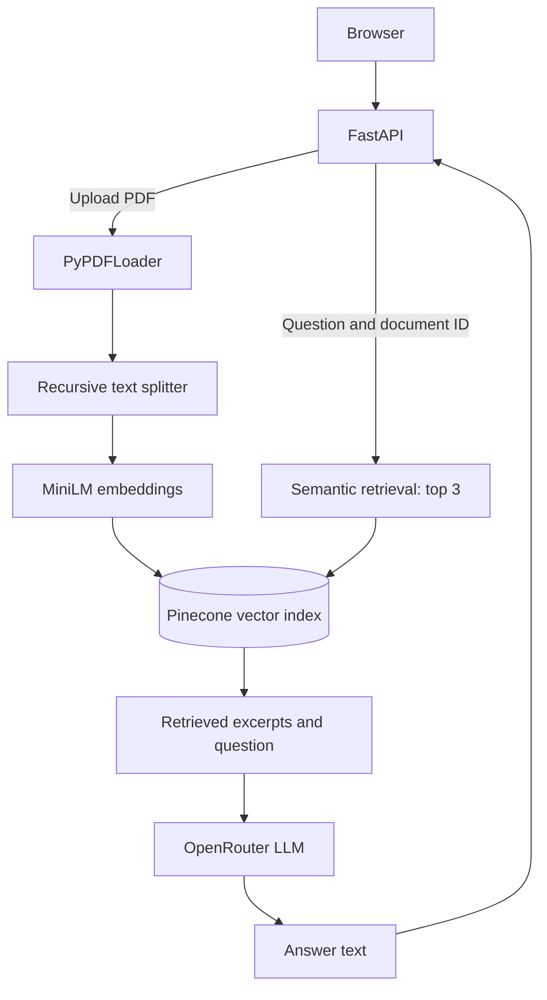

# Ask your PDF — End-to-End RAG Assistant

A document question-answering application that combines semantic search and large language models to help users explore research papers, study materials and other text-based PDFs.

    

## Overview

Traditional PDF readers require users to search documents manually. This project uses retrieval-augmented generation (RAG) to retrieve relevant passages and generate answers from those passages, rather than relying only on a model's general knowledge.

Built as an academic and portfolio project, it covers the full workflow from document ingestion to containerized cloud hosting.

## Features

- Drag-and-drop PDF uploads and multiple document selection.
- Document-specific vector namespaces and semantic search.
- Context-grounded AI answers with an instruction to acknowledge missing evidence.
- Light and dark interface themes, conversation reset and answer copying.
- CPU-oriented Docker deployment and HTTPS cloud demonstration.
- Automatic retry of empty model responses (up to three attempts).

## Architecture



Each upload receives a unique document ID used as its Pinecone namespace. The embedding model produces 384-dimensional vectors; the retrieval chain supplies three relevant chunks to the language model.

## Technology stack

| Layer | Technology |
| --- | --- |
| Interface | HTML, CSS, JavaScript |
| REST API | Python 3.12, FastAPI, Uvicorn |
| Orchestration | LangChain |
| PDF processing | PyPDFLoader, recursive text splitting |
| Embeddings | sentence-transformers/all-MiniLM-L6-v2 |
| Vector storage | Pinecone |
| LLM | OpenRouter, openrouter/free |
| Packaging | Docker, CPU-only PyTorch |
| Cloud demonstration | Azure Linux VM, Caddy HTTPS reverse proxy |

## Getting started

Requirements: Python 3.12 or Docker, internet access, and your own Pinecone and OpenRouter API keys.

```bash
git clone https://github.com/deviprasadchebodula/rag-end-to-end.git
cd rag-end-to-end
cp .env.example .env
```

Edit the local `.env` file with your keys. Never commit it. The application expects a Pinecone dense index named `sentence-vector-index` with 384 dimensions; it attempts to create the index if it is missing. Your account must have the necessary permissions.

### Run with Docker

```bash
docker build -t rag-assistant .
docker run --rm --env-file .env -p 127.0.0.1:8000:8000 rag-assistant
```

Open http://localhost:8000. The first launch may download embedding model weights.

### Run with Python

```bash
python3.12 -m venv .venv
source .venv/bin/activate
python -m pip install -r requirements.txt
python -m uvicorn app:app --host 127.0.0.1 --port 8000
```

Use the Docker route if CPU-only PyTorch installation or dependency resolution is difficult on your platform.

## API reference

| Method | Endpoint | Purpose |
| --- | --- | --- |
| GET | / | Document assistant UI |
| POST | /upload | Multipart PDF upload (field: file) |
| POST | /ask | JSON question and doc_id |
| GET | /docs | Interactive FastAPI API documentation |

See [API examples](docs/API.md) for request and response formats.

## Project structure

```text
rag-end-to-end/
├── app.py              # FastAPI endpoints
├── index.html          # Browser interface
├── data_loader.py      # PDF extraction
├── models.py           # Embedding and LLM configuration
├── prompt.py           # Context-based prompt
├── rag.py              # Ingestion and retrieval pipeline
├── vector_db.py        # Legacy vector database helper
├── requirements.txt   # Python dependencies
├── Dockerfile          # CPU-oriented image
├── .env.example        # Credential placeholders
├── docs/               # API and deployment guides
└── .github/workflows/  # Lightweight syntax checks
```

## Cloud demonstration

The application was demonstrated on an Azure Linux VM using Docker, a public DNS hostname and Caddy HTTPS. An image was also uploaded to Azure Container Registry. Azure App Service deployment was attempted but blocked by subscription quota; it is not the active hosting method.

The cloud demonstration is temporary and depends on available Azure credits and external API availability. For reproducible setup, see [Deployment guide](docs/DEPLOYMENT.md).

## Limitations and responsible use

- This is an educational prototype, not a production-ready multi-tenant service.
- Authentication, document ownership checks, upload size limits and server-side document deletion are not implemented.
- Use only non-confidential documents; retrieved excerpts are sent to an external LLM provider.
- PDF extraction does not include OCR. Scanned or complex documents may need preprocessing.
- Retrieval is limited to three chunks. Answers and source references may be incomplete or inaccurate; source numbering is not yet enforced.
- Free model availability and small cloud instances can cause latency, empty responses or errors.
- Fresh dependency builds and end-to-end tests require verification. Syntax checks are not a substitute for integration tests.

## Roadmap

- [ ] User authentication and document authorization
- [ ] File size limits, retention and deletion
- [ ] Verified page-level citations
- [ ] Latency measurement and bounded model retries
- [ ] Automated API and retrieval tests
- [ ] Reproducible cloud deployment and CI/CD

## Documentation

[API reference](docs/API.md) · [Cloud deployment](docs/DEPLOYMENT.md) · [Security](SECURITY.md) · [Contributing](CONTRIBUTING.md)

Developed by [deviprasadchebodula](https://github.com/deviprasadchebodula) as an academic RAG engineering project.
